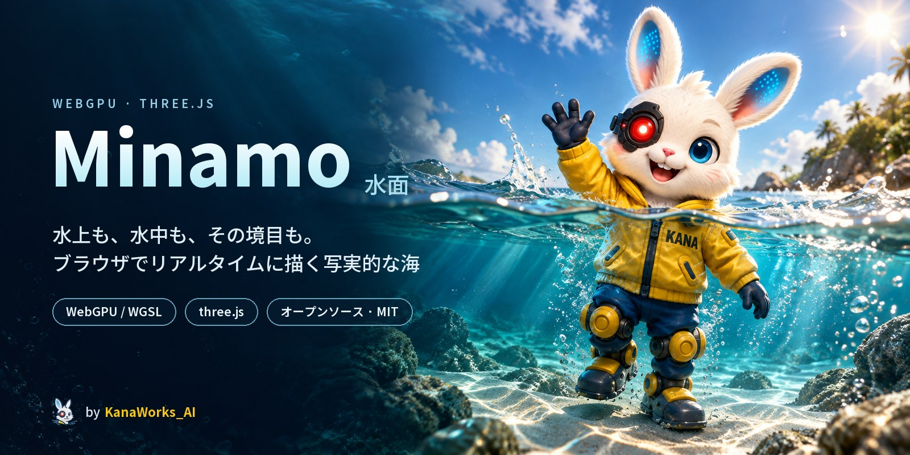
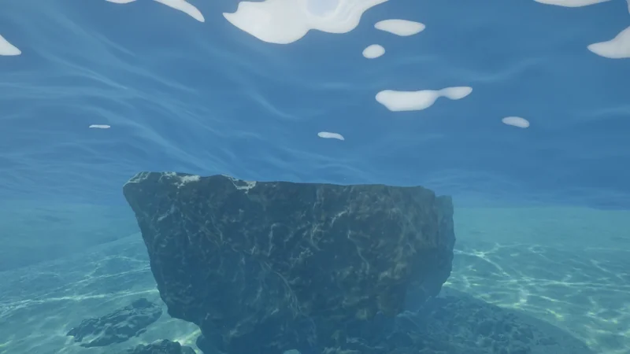
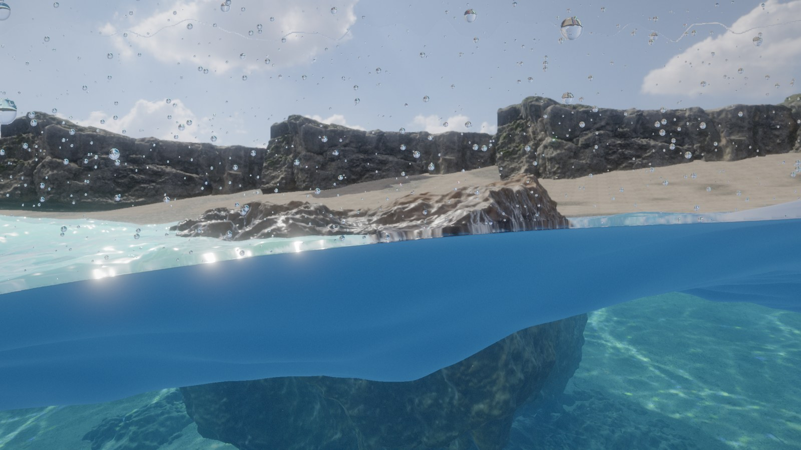
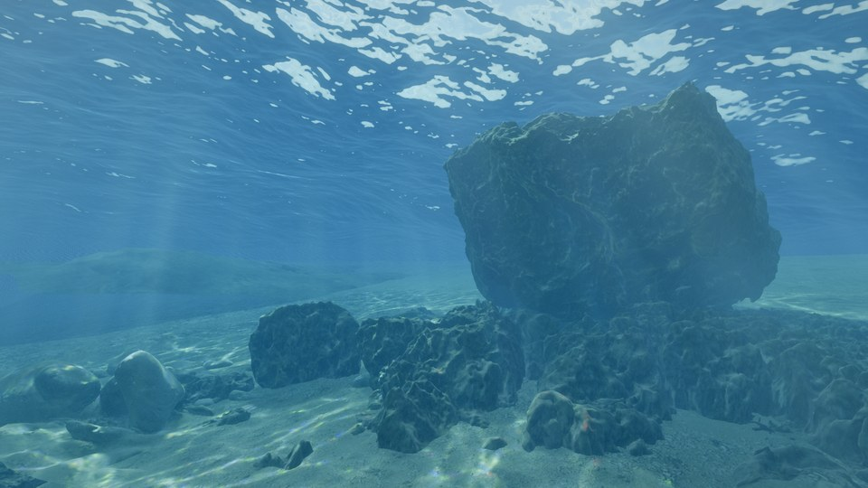
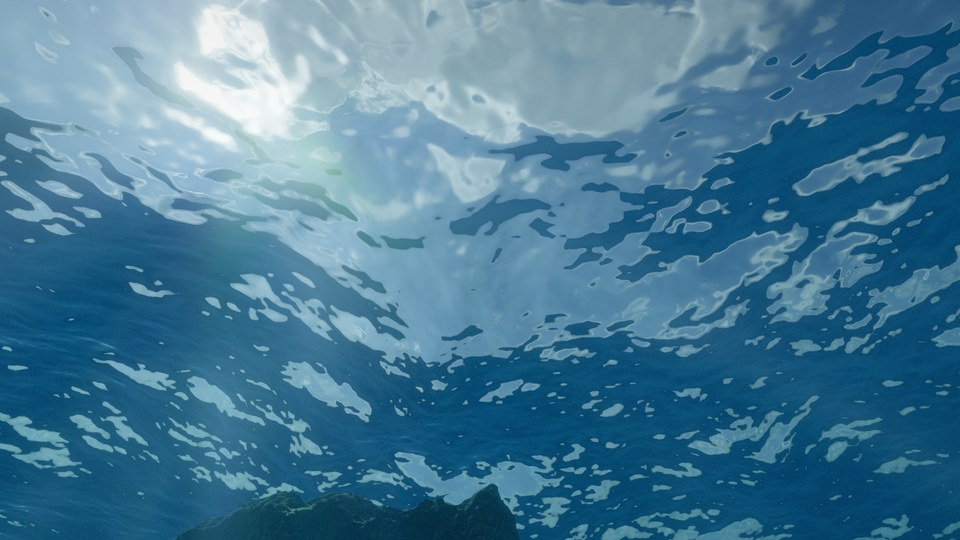
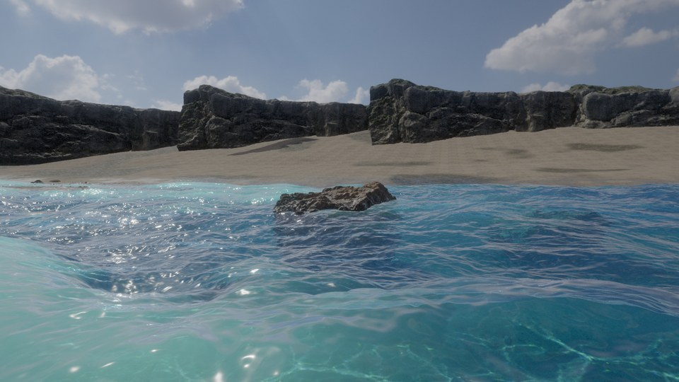
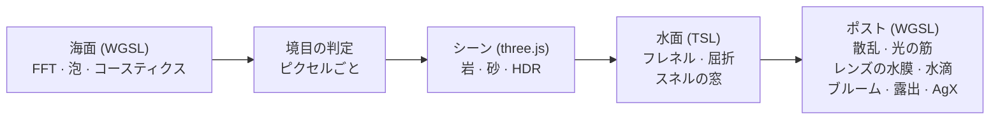

<div align="center">



<p>
  <a href="LICENSE"></a>
  
  <a href="https://threejs.org"></a>
  
  <a href="https://github.com/kanaworksai-hue/minamo/stargazers"></a>
</p>

<p><a href="https://github.com/kanaworksai-hue"></a>&nbsp;<a href="https://github.com/kanaworksai-hue"><b>A KanaWorks_AI project</b></a></p>

[English](README.md) | [简体中文](README.zh-CN.md) | **日本語**

[クイックスタート](#-クイックスタート) · [操作](#-操作) · [しくみ](#-しくみ) · [パフォーマンス](#-パフォーマンス) · [FAQ](#-faq) · [⭐ Star](#-気に入ったら-star-を)

</div>

**Minamo（水面）** は、ブラウザで動くリアルタイムの水のレンダラーです。**水の上、水の中、そしてカメラが半分沈んだときの水面の境目**を、写真のような見た目で描くことを目指しています。FFT による海面、水中での光の吸収と散乱、コースティクス、光の筋（ゴッドレイ）、スネルの窓、波に正確に沿う水面の境目、水から出たあとレンズを流れ落ちる水膜と水滴まで入っています。

[three.js](https://threejs.org)（`WebGPURenderer`）と、同じ WebGPU デバイス上で動く自前の WGSL コンピュート / レンダーパスで作っています。ゲームエンジンもプラグインも不要です。`npm ci && npm run dev` を実行して Chrome で開くだけです。

<p align="center">
  
  <br><sub>水面に浮上する瞬間。境目がレンズを横切り、水膜が流れ落ち、水滴がガラスを伝います。デモからそのまま書き出した映像です。</sub>
</p>

## ✨ 特長

<table>
<tr>
<td align="center" width="50%"><br><b>半水面</b><br><sub>水面メッシュと同じ波の関数でピクセルごとに水の内外を判定。メニスカスの帯、流れ落ちる水膜、レンズを伝う水滴つき</sub></td>
<td align="center" width="50%"><br><b>水中</b><br><sub>RGB ごとの吸収と単一散乱、あらゆる面に落ちる色分散つきのコースティクス、レイマーチングによる光の筋</sub></td>
</tr>
<tr>
<td align="center"><br><b>見上げる</b><br><sub>屈折した空が見えるスネルの窓と、その外側の全反射</sub></td>
<td align="center"><br><b>水上</b><br><sub>3 段カスケードの FFT 海面、フレネル、太陽のきらめき、屈折、泡、CC0 の 3D スキャンした岩</sub></td>
</tr>
</table>

- **正確な境目。** カメラのニアプレーンは幅数センチしかないので、波の高さの計算を少しでも省略すると画面全体にギザギザの線が出ます。水面と境目の判定は同じ関数を使い、いちばん細かい波は 3 次 B スプラインで補間しています。
- **浮かぶカメラ。** デモのカメラは防水ハウジングを手持ちしているように波に揺られるので、境目が何度もレンズを横切ります。
- **物理ベースの水。** 透明な熱帯の海の吸収・散乱係数、前方に強い位相関数、岩の一つひとつ、砂の一粒一粒まで水深に応じて減衰する光。
- **いじりやすい。** パラメータはすべて 1 ファイルとライブパネルにまとまっていて、どの数値も URL から変えられます。

## 🚀 クイックスタート

**必要なもの：**

- WebGPU が使えるデスクトップのブラウザ：最近の **Chrome** か Edge。デスクトップの GPU 向けです。スマホや内蔵 GPU では重くなります
- [Node.js](https://nodejs.org) 22.12 以降
- `git`

```bash
git clone https://github.com/kanaworksai-hue/minamo.git
cd minamo
npm ci
npm run dev
```

http://localhost:5195/ を開くと、水上から海底へ潜って戻ってくる 37 秒のデモが再生されます。

素材（CC0 の岩、テクスチャ、空で約 27 MB）はリポジトリに入っているので、ほかにダウンロードするものはありません。

> [!TIP]
> **GPU が 2 つあるノート PC の場合**、Chrome は WebGPU を内蔵 GPU で動かすことが多く、かなり遅くなります。Windows なら「設定 → システム → ディスプレイ → グラフィック」で Chrome を「高パフォーマンス」にするか、`npm run dev` を起動した状態で `node tools/capture.mjs --view` を実行してください。NVIDIA GPU を使う別プロファイルの Chrome が起動します。

## 🎮 操作

| 入力 | 動作 |
|---|---|
| マウスでドラッグ | 見回す（自由飛行カメラに切り替わります） |
| **Space** | デモと自由飛行カメラを切り替え |
| **W A S D**、**Q E** | 移動、下降 / 上昇（**Shift** を押しながらで速く） |
| **1** – **6** | 固定アングル：above · half · under · snell · shafts · shore |
| **0** | デモに戻る |
| **P** | パスごとの GPU 時間を表示 |

右上のパネルで、波、水の光学特性、コースティクス、レンズ、カメラをその場で調整できます。

**URL オプション：**

| オプション | 効果 |
|---|---|
| `?quality=high` / `medium` / `low` | 画質プリセット（既定は `high`） |
| `?renderScale=1.5&godraySteps=64` | [`src/params.js`](src/params.js) の任意の数値 |
| `?debugMask=1` | 水中と判定したピクセルを赤く表示 |

## 🧭 しくみ



three.js がシーンと水面を描き、海面シミュレーション、コースティクス、水中の媒質、レンズ、ポストプロセスは同じ `GPUDevice` 上の WGSL パスで処理します。各ステップの詳細、数式、参考文献は **[docs/HOW_IT_WORKS.md](docs/HOW_IT_WORKS.md)**（英語）にあります。

```
src/
  main.js              フレームループ、カメラ、パネル
  params.js            すべての調整値、画質プリセット、URL での上書き
  sequence.js          デモのカメラパス
  ocean/               FFT 海面、スペクトル、コースティクス、水面マテリアル (TSL)
  post/                WGSL のポストプロセス、レンズの水滴
  scene/               空と太陽、地形、岩、浮遊粒子
  perf/gpuProfiler.js  パスごとの GPU タイムスタンプ
tools/
  capture.mjs          実際の Chrome でスクリーンショット、動画、ベンチマーク
  build_assets.mjs     元素材から public/assets/ を作り直す
  fetch_assets.py      Poly Haven から元素材をダウンロード
```

## ⚡ パフォーマンス

ノート PC の RTX 4070、1920×1080 出力で、1 フレームの GPU 時間は既定の `high` でおよそ 7 ms、`medium` で約 5 ms、`low` で約 4 ms です。

| プリセット | 内容 |
|---|---|
| `high` | 1.25 倍で描いて縮小（TAA なし）、光の筋 40 ステップ |
| `medium` | 等倍、光の筋 40 ステップ |
| `low` | 0.8 倍、光の筋 24 ステップ |

時間の内訳、計測方法、まだ速くできるところは **[docs/PERFORMANCE.md](docs/PERFORMANCE.md)**（英語）にまとめています。

## 🎬 スクリーンショットと動画

`tools/capture.mjs` は DevTools プロトコルで実際の Chrome を操作します（追加の npm パッケージは不要）。先にビルドしてください。

```bash
npm run build
node tools/capture.mjs --shots out/shots                  # 固定アングルごとに PNG 1 枚
node tools/capture.mjs --seqshots out/seq --times 2,8,29  # デモの指定時刻の静止画
node tools/capture.mjs --video out/demo.mp4 --fps 30      # 37 秒のデモ全体を 1 フレームずつ書き出し（ffmpeg が必要）
node tools/capture.mjs --bench 240                        # パスごとの GPU 時間
```

固定の時間刻みでオフライン描画するので、GPU が遅くても動画はなめらかで、スクリーンショットも毎回同じになります。`capture.mjs` は Windows の Chrome 向けに作っていて、NVIDIA GPU を自動で選びます。ほかの環境では `--chrome <パス>` を指定してください。

## 🪨 素材

素材はすべて [Poly Haven](https://polyhaven.com) の CC0 です。一覧は [LICENSES.md](LICENSES.md) にあります。リポジトリには Web 用に変換したものが入っています。元素材から作り直す場合：

```bash
npm run fetch     # 元素材を assets_src/ にダウンロード（Python 3）
npm run assets    # LOD、meshopt 圧縮、WebP、圧縮 EXR の空
```

空の変換には `pip install OpenEXR numpy` が必要です。Python 3 が `py`（Windows）や `python3` でない場合は `PYTHON=...` を指定してください。

## ❓ FAQ

<details>
<summary><b>「WebGPU が使えません」と出る</b></summary>

最近のデスクトップ版 Chrome か Edge を使ってください。Linux ではまだ `chrome://flags/#enable-unsafe-webgpu` が必要な場合があります。Safari や Firefox も最近のバージョンは WebGPU に対応していますが、Minamo は Chrome でしか確認していません。
</details>

<details>
<summary><b>動作が重い</b></summary>

まずブラウザが専用 GPU を使っているか確認し（[クイックスタート](#-クイックスタート)のヒント参照）、`?quality=medium` か `?quality=low` を試してください。**P** キーでどのパスが重いか見られます。
</details>

<details>
<summary><b>スマホで動きますか？</b></summary>

デスクトップの GPU 向けに作っていて、スマホ向けの最適化はしていません。
</details>

<details>
<summary><b>自分のプロジェクトで使えますか？</b></summary>

はい。コードは MIT、素材は CC0 です。例外は KanaWorks_AI のブランド画像だけです。[ライセンスとクレジット](#-ライセンスとクレジット)をご覧ください。
</details>

## 🗺️ ロードマップ

- [x] レンズ効果つきの水上 / 水中 / 半水面のリアルタイム描画
- [x] パスごとの計測と画質プリセット
- [ ] 光の筋に岩の影を落とす
- [ ] テンポラルアンチエイリアシング（TAA）
- [ ] 被写界深度

Issue やプルリクエストを歓迎します。

## ⭐ 気に入ったら Star を

Minamo を見て「おっ」と思ったら、[リポジトリページ](https://github.com/kanaworksai-hue/minamo)右上の **⭐ Star** を押してもらえるとうれしいです。ほかの人が見つけやすくなり、次のアップデートの励みになります。

バグやアイデアは [Issue](https://github.com/kanaworksai-hue/minamo/issues) へどうぞ。スクリーンショットを X でシェアするときは [@KanaWorks_AI](https://x.com/KanaWorks_AI) をメンションしてもらえるとうれしいです。

## 📄 ライセンスとクレジット

- **このプロジェクト：** [MIT](LICENSE)。
- **素材：** [Poly Haven](https://polyhaven.com) の CC0。[LICENSES.md](LICENSES.md) を参照。
- **ブランド：** KanaWorks_AI の名称、ロゴ、キャラクター Kana の権利は東京AI映像合同会社に帰属し、MIT ライセンスの対象**外**です。[docs/brand](docs/brand/README.md) を参照してください。
- **使用しているもの：** [three.js](https://threejs.org)、[Vite](https://vite.dev)。手法と論文のクレジットは [docs/HOW_IT_WORKS.md](docs/HOW_IT_WORKS.md#references) にあります。
- **インスピレーション：** William Faucher さんの Unreal Engine 用 EasyWaterscape の見た目。コードや素材は一切使っていません。

<br>

<div align="center">

<a href="https://x.com/KanaWorks_AI"></a>

<p><b>Made with ♥ by <a href="https://x.com/KanaWorks_AI">KanaWorks_AI</a></b></p>

<p><sub>Minamo を気に入ったら ⭐ をお願いします。ほかのプロジェクト：<a href="https://github.com/kanaworksai-hue">github.com/kanaworksai-hue</a></sub></p>

</div>
