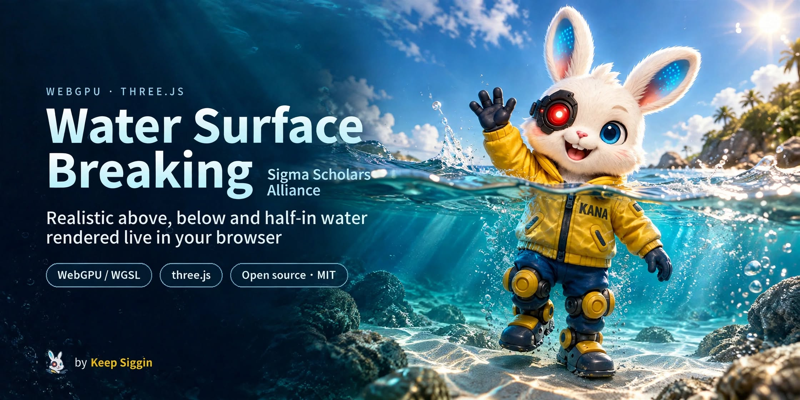
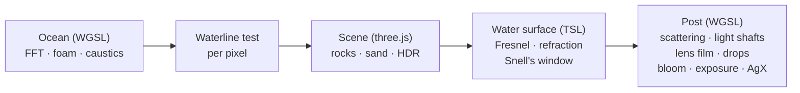

<div align="center">



<p>
  <a href="LICENSE"></a>
  
  <a href="https://threejs.org"></a>
  
  <a href="https://github.com/ericeisaman/water-surface-breaking/stargazers"></a>
</p>

<p><a href="https://github.com/ericeisaman"></a>&nbsp;<a href="https://github.com/ericeisaman"><b>A KanaWorks_AI project</b></a></p>

**English** | [简体中文](README.zh-CN.md) | [日本語](README.ja.md)

[Quick start](#-quick-start) · [Controls](#-controls) · [How it works](#-how-it-works) · [Performance](#-performance) · [FAQ](#-faq) · [⭐ Star](#-like-it-star-it)

</div>

**water-surface-breaking** (水面, "the water's surface") is a real-time water renderer for the browser. It aims for a photographic look **above the water, under it, and right at the waterline** when a camera is half submerged: an FFT ocean, light absorption and scattering in the water, caustics, light shafts, Snell's window, a waterline that follows every wave exactly, and water running down the lens after the camera comes up.

It is built on [three.js](https://threejs.org) (`WebGPURenderer`) plus hand-written WGSL compute and render passes that share the same WebGPU device. No game engine, no plugins: `npm ci && npm run dev` and open Chrome.

<p align="center">
  
  <br><sub>Coming up for air: the waterline sweeps across the lens, then the water film drains off and drops slide down the glass. Captured from the demo.</sub>
</p>

## ✨ Highlights

<table>
<tr>
<td align="center" width="50%"><br><b>Over-under</b><br><sub>The waterline is tested per pixel against the same wave function as the water mesh, with a meniscus band, a draining water film and sliding drops on the lens</sub></td>
<td align="center" width="50%"><br><b>Under water</b><br><sub>Per-channel absorption and single scattering, chromatic caustics on every surface, ray-marched light shafts</sub></td>
</tr>
<tr>
<td align="center"><br><b>Looking up</b><br><sub>Snell's window with the refracted sky, total internal reflection outside it</sub></td>
<td align="center"><br><b>Above</b><br><sub>Three-cascade FFT ocean, Fresnel, sun glints, refraction, foam and scanned CC0 rocks</sub></td>
</tr>
</table>

- **Exact waterline.** The camera's near plane is only a few centimetres wide, so any shortcut in the wave lookup shows up as a jagged line across the screen. The water surface and the waterline test share one function, with cubic B-spline filtering for the finest waves.
- **A camera that floats.** The demo camera rides the swell like a handheld waterproof housing, so the waterline keeps crossing the lens.
- **Physically based water.** Absorption and scattering coefficients of a clear tropical sea, a forward-scattering phase function, light attenuated with depth on every rock and grain of sand.
- **Hackable.** Every parameter is in one file and on a live panel, and any number can be set from the URL.

## 🚀 Quick start

**Requirements:**

- A desktop browser with WebGPU: a recent **Chrome** or Edge. water-surface-breaking targets desktop GPUs; phones and integrated graphics will be slow
- [Node.js](https://nodejs.org) 22.12 or later
- `git`

```bash
git clone https://github.com/ericeisaman/water-surface-breaking.git
cd water-surface-breaking
npm ci
npm run dev
```

Open http://localhost:5195/. The demo starts playing a 37-second camera path from above the water to the seabed and back up.

The assets (about 27 MB of CC0 rocks, textures and sky) are already in the repository, so there is nothing else to download.

> [!TIP]
> **Laptop with two GPUs?** Chrome often runs WebGPU on the integrated GPU, which is much slower. On Windows, set Chrome to "High performance" in *Settings → System → Display → Graphics*, or, with `npm run dev` running, open the page with `node tools/capture.mjs --view`, which starts a separate Chrome profile on the NVIDIA GPU.

## 🎮 Controls

| Input | Action |
|---|---|
| Drag the mouse | Look around (switches to the free-fly camera) |
| **Space** | Switch between the demo and the free-fly camera |
| **W A S D**, **Q E** | Move, down / up (hold **Shift** to go faster) |
| **1** – **6** | Fixed views: above · half · under · snell · shafts · shore |
| **0** | Back to the demo path |
| **P** | Per-pass GPU timings |

The panel on the top right edits waves, water optics, caustics, the lens and the camera live.

**URL options:**

| Option | Effect |
|---|---|
| `?quality=high` / `medium` / `low` | Quality preset (default `high`) |
| `?renderScale=1.5&godraySteps=64` | Any number from [`src/params.js`](src/params.js) |
| `?debugMask=1` | Tint under-water pixels red |

## 🧭 How it works



three.js draws the scene and the water surface. The ocean simulation, caustics, underwater medium, lens and post-processing are WGSL passes on the same `GPUDevice`. **[docs/HOW_IT_WORKS.md](docs/HOW_IT_WORKS.md)** walks through every step, with the formulas and references.

```
src/
  main.js              frame loop, camera, panel
  params.js            every tunable, quality presets, URL overrides
  sequence.js          the demo camera path
  ocean/               FFT ocean, spectrum, caustics, water material (TSL)
  post/                WGSL post-processing, lens drops
  scene/               sky + sun, terrain, rocks, particles
  perf/gpuProfiler.js  per-pass GPU timestamps
tools/
  capture.mjs          screenshots, videos and benchmarks in a real Chrome
  build_assets.mjs     rebuilds public/assets/ from the originals
  fetch_assets.py      downloads the Poly Haven originals
```

## ⚡ Performance

On a laptop RTX 4070 at 1920×1080 output, one frame takes roughly 7 ms of GPU time with the default `high` preset, about 5 ms with `medium` and about 4 ms with `low`.

| Preset | What it does |
|---|---|
| `high` | Renders at 1.25× and downsamples (no TAA), 40 light-shaft steps |
| `medium` | Native resolution, 40 light-shaft steps |
| `low` | 0.8× resolution, 24 light-shaft steps |

Where the time goes, how to profile it and what could still be faster: **[docs/PERFORMANCE.md](docs/PERFORMANCE.md)**.

## 🎬 Screenshots and videos

`tools/capture.mjs` drives a real Chrome over the DevTools protocol (no extra npm packages). Build first:

```bash
npm run build
node tools/capture.mjs --shots out/shots                  # one PNG per fixed view
node tools/capture.mjs --seqshots out/seq --times 2,8,29  # stills from the demo path
node tools/capture.mjs --video out/demo.mp4 --fps 30      # the whole 37 s demo, frame by frame (needs ffmpeg)
node tools/capture.mjs --bench 240                        # per-pass GPU timings
```

Frames are rendered offline at a fixed time step, so videos are smooth however slow the GPU is, and screenshots are deterministic. `capture.mjs` is set up for Chrome on Windows (it picks the NVIDIA GPU by itself); elsewhere pass `--chrome <path>`.

## 🪨 Assets

All assets are CC0 from [Poly Haven](https://polyhaven.com); the list is in [LICENSES.md](LICENSES.md). The repository contains the processed web versions. To rebuild them from the originals:

```bash
npm run fetch     # downloads the originals into assets_src/ (Python 3)
npm run assets    # LODs, meshopt compression, WebP, compressed EXR sky
```

Converting the sky needs `pip install OpenEXR numpy`. Set `PYTHON=...` if your Python 3 is not `py` (Windows) or `python3`.

## ❓ FAQ

<details>
<summary><b>"WebGPU not available"</b></summary>

Use a recent desktop Chrome or Edge. On Linux, WebGPU may still need `chrome://flags/#enable-unsafe-webgpu`. Safari and Firefox support WebGPU in recent versions too, but water-surface-breaking is only tested in Chrome.
</details>

<details>
<summary><b>It runs slowly</b></summary>

Check that the browser uses your dedicated GPU (see the tip in [Quick start](#-quick-start)), then try `?quality=medium` or `?quality=low`. Press **P** to see which passes are expensive.
</details>

<details>
<summary><b>Does it work on phones?</b></summary>

It is made for desktop GPUs and is not optimised for phones.
</details>

<details>
<summary><b>Can I use it in my own project?</b></summary>

Yes. The code is MIT and the assets are CC0. The KanaWorks_AI brand images are the only exception; see [License and credits](#-license-and-credits).
</details>

## 🗺️ Roadmap

- [x] Real-time over / under / half-in water with lens effects
- [x] Per-pass profiling and quality presets
- [ ] Rock shadows inside the light shafts
- [ ] Temporal anti-aliasing
- [ ] Depth of field

Issues and pull requests are welcome.

## ⭐ Like it? Star it

If water-surface-breaking made you look twice at a browser tab, please click **⭐ Star** at the top of the [repository page](https://github.com/ericeisaman/water-surface-breaking). It helps other people find it and keeps me working on the next update.

You can also [open an issue](https://github.com/ericeisaman/water-surface-breaking/issues) with a bug or an idea, or share a screenshot on X and tag [@KanaWorks_AI](https://x.com/KanaWorks_AI).

## 📄 License and credits

- **This project:** [MIT](LICENSE).
- **Assets:** CC0 from [Poly Haven](https://polyhaven.com); see [LICENSES.md](LICENSES.md).
- **Brand:** the KanaWorks_AI name, logo and the Kana character are © 東京AI映像合同会社 (Tokyo AI Visuals LLC) and are **not** covered by the MIT license. See [docs/brand](docs/brand/README.md).
- **Built on:** [three.js](https://threejs.org) and [Vite](https://vite.dev). Techniques and papers are credited in [docs/HOW_IT_WORKS.md](docs/HOW_IT_WORKS.md#references).
- **Inspiration:** the look of William Faucher's EasyWaterscape for Unreal Engine. water-surface-breaking uses none of its code or assets.

<br>

<div align="center">

<a href="https://x.com/KanaWorks_AI"></a>

<p><b>Made with ♥ by <a href="https://x.com/KanaWorks_AI">KanaWorks_AI</a></b></p>

<p><sub>If water-surface-breaking made you smile, a ⭐ helps others find it. More projects: <a href="https://github.com/ericeisaman">github.com/ericeisaman</a></sub></p>

</div>
