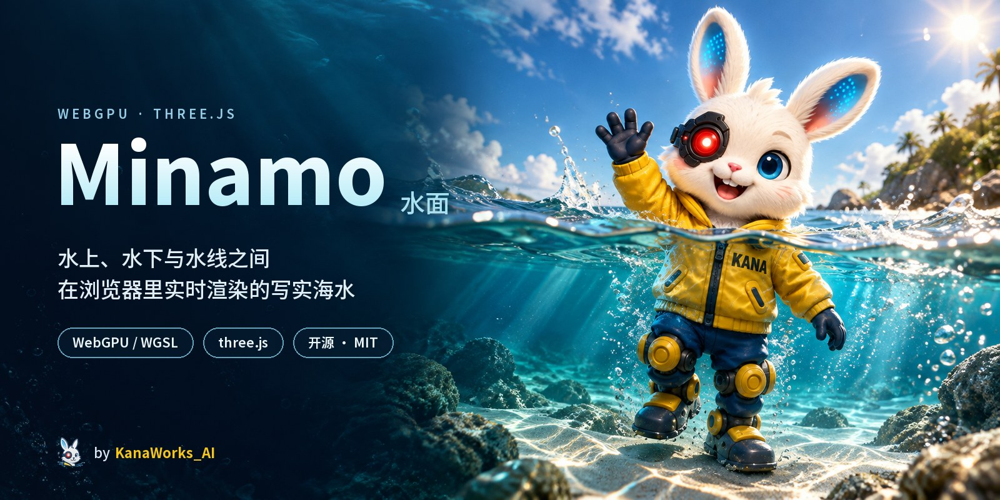
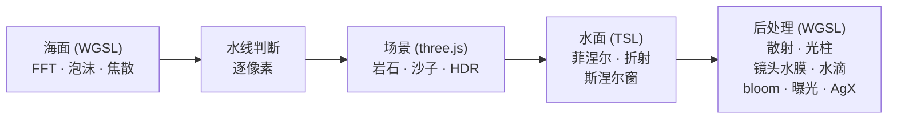

<div align="center">



<p>
  <a href="LICENSE"></a>
  
  <a href="https://threejs.org"></a>
  
  <a href="https://github.com/kanaworksai-hue/minamo/stargazers"></a>
</p>

<p><a href="https://github.com/kanaworksai-hue"></a>&nbsp;<a href="https://github.com/kanaworksai-hue"><b>A KanaWorks_AI project</b></a></p>

[English](README.md) | **简体中文** | [日本語](README.ja.md)

[快速开始](#-快速开始) · [操作](#-操作) · [原理](#-原理) · [性能](#-性能) · [FAQ](#-faq) · [⭐ Star](#-喜欢就点个-star)

</div>

**Minamo（水面）** 是一个在浏览器里运行的实时水面渲染器。目标是让**水上、水下，以及相机半入水时的水线**都达到照片般的效果：FFT 海面、水中光的吸收和散射、焦散、光柱、斯涅尔窗、严格贴合每一道波浪的水线，以及相机出水后顺着镜头流下的水膜和水滴。

它基于 [three.js](https://threejs.org)（`WebGPURenderer`），再加上跑在同一个 WebGPU 设备上的手写 WGSL 计算 / 渲染 pass。不需要游戏引擎，也不需要插件：`npm ci && npm run dev`，打开 Chrome 就能看。

<p align="center">
  
  <br><sub>浮出水面的瞬间：水线扫过镜头，水膜流走，水滴顺着玻璃滑下。直接从演示里导出。</sub>
</p>

## ✨ 亮点

<table>
<tr>
<td align="center" width="50%"><br><b>半入水</b><br><sub>用和水面网格完全相同的波浪函数逐像素判断水线，带弯月面、流下的水膜和滑落的水滴</sub></td>
<td align="center" width="50%"><br><b>水下</b><br><sub>按 RGB 通道计算吸收和单次散射，所有表面都有带色散的焦散，光柱用光线步进计算</sub></td>
</tr>
<tr>
<td align="center"><br><b>向上看</b><br><sub>斯涅尔窗里是折射后的天空，窗外是全反射</sub></td>
<td align="center"><br><b>水上</b><br><sub>三级级联 FFT 海面、菲涅尔、太阳耀光、折射、泡沫和 CC0 扫描岩石</sub></td>
</tr>
</table>

- **精确的水线。** 相机近平面只有几厘米宽，查波浪时稍微偷懒，屏幕上就会出现一条锯齿线。水面和水线判断共用同一个函数，最细的一级波浪用三次 B 样条插值。
- **会漂浮的相机。** 演示相机像手持防水壳一样随浪起伏，水线会一次次扫过镜头。
- **基于物理的海水。** 清澈热带海水的吸收和散射系数、强前向散射的相函数，每块岩石、每粒沙子上的光都按水深衰减。
- **易于修改。** 所有参数都在一个文件里，也都能在面板上实时调，任何数值都可以通过 URL 修改。

## 🚀 快速开始

**需要：**

- 支持 WebGPU 的桌面浏览器：较新的 **Chrome** 或 Edge。面向桌面 GPU，手机和核显会比较卡
- [Node.js](https://nodejs.org) 22.12 或更高版本
- `git`

```bash
git clone https://github.com/kanaworksai-hue/minamo.git
cd minamo
npm ci
npm run dev
```

打开 http://localhost:5195/ ，会自动播放一段 37 秒的演示：从水上潜到海底，再浮出水面。

素材（CC0 的岩石、贴图和天空，约 27 MB）已经在仓库里，不用另外下载。

> [!TIP]
> **双显卡笔记本？** Chrome 经常把 WebGPU 放在核显上，会慢很多。Windows 上可以在「设置 → 系统 → 屏幕 → 显示卡」里把 Chrome 设成「高性能」；或者在 `npm run dev` 运行时执行 `node tools/capture.mjs --view`：它会用独立的配置文件在 NVIDIA 显卡上启动 Chrome。

## 🎮 操作

| 输入 | 作用 |
|---|---|
| 拖动鼠标 | 环顾四周（切换到自由飞行相机） |
| **Space** | 在演示和自由飞行相机之间切换 |
| **W A S D**、**Q E** | 移动、下降 / 上升（按住 **Shift** 加速） |
| **1** – **6** | 固定机位：above · half · under · snell · shafts · shore |
| **0** | 回到演示 |
| **P** | 显示每个 pass 的 GPU 时间 |

右上角的面板可以实时调整波浪、水的光学参数、焦散、镜头和相机。

**URL 参数：**

| 参数 | 作用 |
|---|---|
| `?quality=high` / `medium` / `low` | 画质档位（默认 `high`） |
| `?renderScale=1.5&godraySteps=64` | [`src/params.js`](src/params.js) 里的任意数值 |
| `?debugMask=1` | 把判定为水下的像素染成红色 |

## 🧭 原理



three.js 负责画场景和水面；海面模拟、焦散、水下介质、镜头和后处理都是同一个 `GPUDevice` 上的 WGSL pass。每一步的细节、公式和参考文献见 **[docs/HOW_IT_WORKS.md](docs/HOW_IT_WORKS.md)**（英文）。

```
src/
  main.js              帧循环、相机、面板
  params.js            所有可调参数、画质档位、URL 覆盖
  sequence.js          演示的相机路径
  ocean/               FFT 海面、频谱、焦散、水面材质 (TSL)
  post/                WGSL 后处理、镜头水滴
  scene/               天空和太阳、地形、岩石、悬浮颗粒
  perf/gpuProfiler.js  逐 pass 的 GPU 时间戳
tools/
  capture.mjs          在真实 Chrome 里截图、录视频、测性能
  build_assets.mjs     从原始素材重新生成 public/assets/
  fetch_assets.py      从 Poly Haven 下载原始素材
```

## ⚡ 性能

在笔记本 RTX 4070、1920×1080 输出下，默认的 `high` 档每帧 GPU 时间大约 7 ms，`medium` 约 5 ms，`low` 约 4 ms。

| 档位 | 内容 |
|---|---|
| `high` | 按 1.25 倍渲染再缩小（没有 TAA），光柱 40 步 |
| `medium` | 原生分辨率，光柱 40 步 |
| `low` | 0.8 倍分辨率，光柱 24 步 |

时间花在哪里、怎么自己测、还有哪些地方能更快，见 **[docs/PERFORMANCE.md](docs/PERFORMANCE.md)**（英文）。

## 🎬 截图和视频

`tools/capture.mjs` 通过 DevTools 协议控制真实的 Chrome（不需要额外的 npm 包）。先构建：

```bash
npm run build
node tools/capture.mjs --shots out/shots                  # 每个固定机位一张 PNG
node tools/capture.mjs --seqshots out/seq --times 2,8,29  # 演示中指定时间的静帧
node tools/capture.mjs --video out/demo.mp4 --fps 30      # 逐帧导出整段 37 秒的演示（需要 ffmpeg）
node tools/capture.mjs --bench 240                        # 逐 pass GPU 时间
```

画面按固定时间步长离线渲染，所以 GPU 再慢视频也是流畅的，截图每次也完全一样。`capture.mjs` 是按 Windows 上的 Chrome 写的，会自动选用 NVIDIA 显卡；其他环境请用 `--chrome <路径>` 指定 Chrome。

## 🪨 素材

所有素材都来自 [Poly Haven](https://polyhaven.com)，CC0 授权，清单见 [LICENSES.md](LICENSES.md)。仓库里放的是转换好的网页版本。要从原始素材重新生成：

```bash
npm run fetch     # 把原始素材下载到 assets_src/（需要 Python 3）
npm run assets    # LOD、meshopt 压缩、WebP、压缩 EXR 天空
```

转换天空需要 `pip install OpenEXR numpy`。如果你的 Python 3 不叫 `py`（Windows）或 `python3`，请设置 `PYTHON=...`。

## ❓ FAQ

<details>
<summary><b>提示「WebGPU not available」</b></summary>

请使用较新的桌面版 Chrome 或 Edge。Linux 上可能还需要打开 `chrome://flags/#enable-unsafe-webgpu`。新版 Safari 和 Firefox 也支持 WebGPU，但 Minamo 只在 Chrome 上测试过。
</details>

<details>
<summary><b>运行很卡</b></summary>

先确认浏览器用的是独立显卡（见[快速开始](#-快速开始)里的提示），再试试 `?quality=medium` 或 `?quality=low`。按 **P** 可以看到哪些 pass 最耗时。
</details>

<details>
<summary><b>能在手机上跑吗？</b></summary>

它是为桌面 GPU 做的，没有针对手机优化。
</details>

<details>
<summary><b>可以用在自己的项目里吗？</b></summary>

可以。代码是 MIT，素材是 CC0。唯一的例外是 KanaWorks_AI 的品牌图片，见[许可与致谢](#-许可与致谢)。
</details>

## 🗺️ 路线图

- [x] 带镜头效果的水上 / 水下 / 半入水实时渲染
- [x] 逐 pass 计时和画质档位
- [ ] 光柱里的岩石阴影
- [ ] 时域抗锯齿（TAA）
- [ ] 景深

欢迎提 Issue 和 Pull Request。

## ⭐ 喜欢就点个 Star

如果 Minamo 让你多看了两眼，请在[仓库页面](https://github.com/kanaworksai-hue/minamo)右上角点一下 **⭐ Star**。这能让更多人发现它，也是我继续更新的动力。

有 bug 或想法可以[提 Issue](https://github.com/kanaworksai-hue/minamo/issues)；在 X 上分享截图时欢迎带上 [@KanaWorks_AI](https://x.com/KanaWorks_AI)。

## 📄 许可与致谢

- **本项目：** [MIT](LICENSE)。
- **素材：** [Poly Haven](https://polyhaven.com) 的 CC0 素材，见 [LICENSES.md](LICENSES.md)。
- **品牌：** KanaWorks_AI 名称、logo 和 Kana 形象版权归东京AI映像合同会社所有，**不在** MIT 授权范围内，见 [docs/brand](docs/brand/README.md)。
- **基于：** [three.js](https://threejs.org)、[Vite](https://vite.dev)。用到的技术和论文在 [docs/HOW_IT_WORKS.md](docs/HOW_IT_WORKS.md#references) 里注明。
- **灵感：** William Faucher 的 Unreal Engine 插件 EasyWaterscape 的画面效果。没有使用它的任何代码或素材。

<br>

<div align="center">

<a href="https://x.com/KanaWorks_AI"></a>

<p><b>Made with ♥ by <a href="https://x.com/KanaWorks_AI">KanaWorks_AI</a></b></p>

<p><sub>喜欢 Minamo 的话，点个 ⭐ 能让更多人看到它。更多项目：<a href="https://github.com/kanaworksai-hue">github.com/kanaworksai-hue</a></sub></p>

</div>
